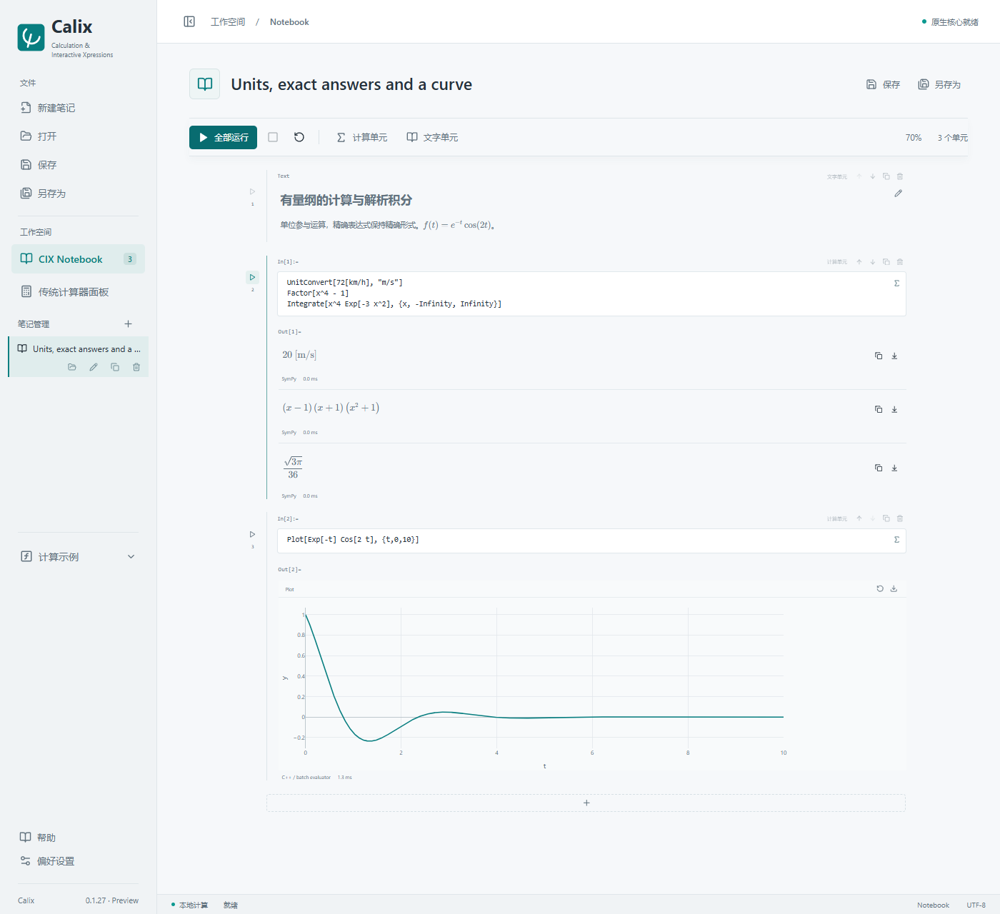

# Calix

**Calculation & Interactive Xpressions**

A local mathematics notebook for calculations with units, symbolic work,
numerical solvers and interactive plots. Keep the input, result and explanation
together. A calculator panel and a JSON command-line interface use the same engine.

[中文](README.zh-CN.md) · [Get Started](docs/GETTING-STARTED.en.md) · [User Guide (中文)](docs/USER-GUIDE.md) · [CLI / API](API.md) · [Contributing](CONTRIBUTING.md)



## Try a Calculation

Paste these lines into a calculation cell and press **Ctrl+Enter**:

```wolfram
1/3 + 1/6
UnitConvert[72[km/h], "m/s"]
Factor[x^4 - 1]
Integrate[x^4 Exp[-3 x^2], {x, -Infinity, Infinity}]
Solve[{x+y==3, x*y==2}, {x,y}]
Plot[Exp[-t] Cos[2 t], {t,0,10}]
```

The first four results are `1/2`, `20[m/s]`, a factored polynomial and
`Sqrt[3 Pi]/36`. Newline-separated expressions produce results in order;
a trailing `;` hides an intermediate definition.

## What You Can Do

| Task | Available today |
|---|---|
| Everyday calculations | Exact fractions, arbitrary-precision evaluation, complex numbers, matrices, sums, products and special functions |
| Engineering quantities | Unit-aware arithmetic and conversion, dimension checks, SI simplification and explicit angle units |
| Algebra and calculus | Factor/expand/simplify, series, derivatives, integrals, equations, ODEs and recurrences |
| Numerical work | Bracketed roots, quadrature, ODE initial-value problems, bounded extrema and fitting |
| Visual exploration | Curves, contours, surfaces, parametric plots, animation and PNG export |
| Working documents | Multiple notebooks, formula input, Markdown with mathematics, saved inputs and outputs |
| Automation | CLI, authenticated loopback API, persistent JSONL, notebook export and desktop handoff |
| Optional PDE module | Documented analytical PDE and numerical FEM/flow cases with explicit model limits |

Calix accepts a **Wolfram-style language subset**, not arbitrary Mathematica
programs. It does not include or require a Wolfram runtime. See
[supported syntax](docs/SUPPORTED-SYNTAX.md) and [PDE scope](docs/PDE.md).
Engineering examples are learning and verification material, not certified design tools.

## Install and Run

The tested desktop target is **Windows x64** with Microsoft Edge WebView2.
The packaged app includes Python and its service; no Python, Node.js or
Mathematica installation is required for end users.

For a distribution obtained from the maintainer, run `Calix_0.1.28_x64-setup.exe`.
A source checkout can generate it under `release/`. Choose **PDE module**,
additional languages and themes as needed. A portable distribution must retain
its adjacent runtime directories. See [installation](docs/INSTALLATION.md).

**Publication status:** the public repository address and application license
have not yet been selected. This checkout remains under its current
[LICENSE](LICENSE), which reserves application-source rights. Readable source
is not automatically open source. No public download URL is advertised until
a release actually exists.

## Start with an Example

Open **Examples / 计算示例**. Full notebooks open as separate documents; small
function demonstrations insert a calculation cell into the current notebook.

- **Air resistance:** analytical linear drag, numerical quadratic drag and trajectories.
- **Elastic double pendulum:** small-motion analysis and large-motion numerical animation.
- **Current loops:** magnetic fields and charged-particle trajectories.
- **Hydrogen-like ion:** deriving and checking bound states from the Schrödinger equation.
- **Engineering PDE:** bridge stresses, wing flow, wave optics and gear contact.

[Example catalog](docs/EXAMPLES.md) · [Calculator preview](docs/images/calculator.png)

## Call Calix from a Script or AI Agent

In PowerShell, from the installation directory:

```powershell
.\calix-cli.exe eval --code 'UnitConvert[72[km/h],"m/s"]' --brief
.\calix-cli.exe eval --file problem.wl --brief --output results.json --notebook answer.cixnb --open-ui
.\calix-cli.exe validate answer.cixnb
```

The first calculation starts a service if necessary. Repeated dependent requests
can use `pipe` or an explicit `--session`. Read [AI-CONTROL.md](AI-CONTROL.md)
for the shortest workflow and [API.md](API.md) for the protocol. Never publish
local API tokens in issue reports or prompts.

## Develop and Contribute

React, CodeMirror, MathLive, KaTeX, Plotly and Three.js provide the UI.
SymPy/Pint and C++20 numerical kernels run in an isolated local service;
Tauri provides the desktop. Optional packages have their own licenses,
including proprietary Intel runtime binaries in the PDE distribution.

[Development setup](docs/DEVELOPMENT.md) covers Windows prerequisites, tests and
packaging. [Contributing](CONTRIBUTING.md) covers reproducible calculation bugs,
documentation and future code contributions, subject to the current license.
Useful contributions include reduced failing expressions, independently checked
examples, translations and reports from other Windows machines.

See the [roadmap](docs/ROADMAP.md) for priorities and
[release preparation](docs/RELEASING.md) for the public-launch checklist.
The [acceptance record](docs/ACCEPTANCE.md) distinguishes automated checks from
clean-machine and external-user validation that still needs to be performed.

## Help

- [Documentation index](docs/README.md)
- [Quick start](docs/GETTING-STARTED.en.md) / [快速上手](docs/GETTING-STARTED.md)
- [User guide / 使用帮助](docs/USER-GUIDE.md)
- [Troubleshooting / 故障排查](docs/TROUBLESHOOTING.md)
- [CPU execution and precision](docs/CPU-ACCELERATION.md)
- [Third-party licensing](docs/LICENSE-REVIEW.md)
- [Latest changes](docs/CHANGES-0.1.28.md)

Version **0.1.28**, engineering preview.
