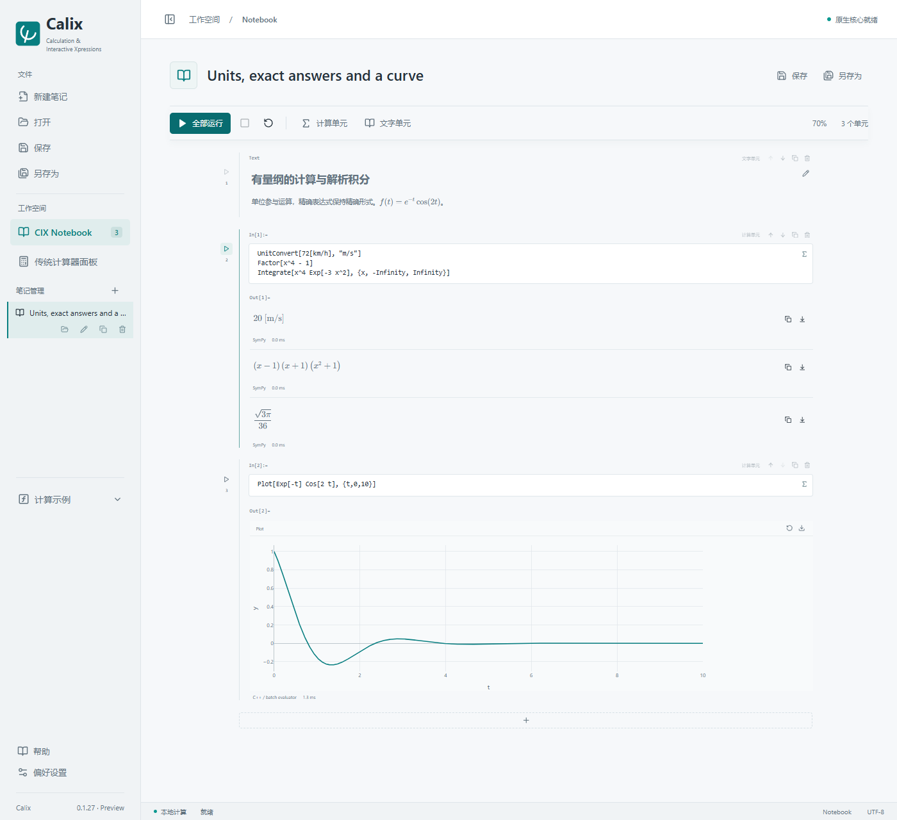

# Calix

**Calculation & Interactive Xpressions**

在本地完成带单位的计算、符号推导、数值求解和交互绘图，把公式、代码、结果与说明保存在同一份笔记本中。传统计算器面板和 AI 命令行接口共用计算引擎。

[English](README.md) · [快速上手](docs/GETTING-STARTED.md) · [使用帮助](docs/USER-GUIDE.md) · [案例目录](docs/EXAMPLES.md) · [参与项目](CONTRIBUTING.md)



## 先算一次

把下面代码粘贴进计算单元，按 **Ctrl+Enter**：

```wolfram
1/3 + 1/6
UnitConvert[72[km/h], "m/s"]
Factor[x^4 - 1]
Integrate[x^4 Exp[-3 x^2], {x, -Infinity, Infinity}]
Solve[{x+y==3, x*y==2}, {x,y}]
Plot[Exp[-t] Cos[2 t], {t,0,10}]
```

前两项得到 `1/2` 和 `20[m/s]`。一行一个表达式会依次输出；用 `;` 隐藏中间赋值的输出，不需要 `Column`。

## 适合做什么

| 场景 | 功能 |
|---|---|
| 学习与日常计算 | 精确数、复数、矩阵、求和求积、超几何等特殊函数 |
| 机械与物理计算 | 单位直接代入、量纲检查、ODE、最值和数据拟合 |
| 符号推导 | 代数化简、级数、求导、积分、方程与差分方程 |
| 图形与笔记 | 曲线、等高线、曲面、参数图、动画、公式输入、Markdown |
| AI 与脚本 | JSON CLI/API、持久会话、标准笔记本导出、完成后打开界面 |
| PDE 学习案例 | 可选 PDE module；支持范围与建模假设见专门文档 |

Calix 使用 Wolfram 风格的**语法子集**，不等于 Mathematica v13 兼容实现，不包含 Wolfram 引擎。有限元与流场案例适用于学习和验证，不能按函数名称推断为通用工程求解器。详见[支持语法](docs/SUPPORTED-SYNTAX.md)和 [PDE 文档](docs/PDE.md)。

## 安装

当前已测试平台为 **Windows x64**，需要 Microsoft Edge WebView2。安装版自带计算服务与 Python，不需要另装 Python、Node.js 或 Mathematica。

取得维护者提供的发行包后，运行 `Calix_0.1.28_x64-setup.exe`。安装时可选 PDE module、附加语言和皮肤。便携版应保留相邻运行目录，不能只复制一个 exe。见[安装与升级](docs/INSTALLATION.md)。

**发布状态：**公开 GitHub 地址与开源许可证尚未确定。当前源码仍适用 [LICENSE](LICENSE) 中的保留权利条款，尚未授予开放源码许可。文档暂不提供不存在的公开下载地址；后续公开发行以实际仓库和发布说明为准。

## 从案例开始

左侧打开“计算示例”。完整案例会打开独立笔记本；基础功能示例会追加到当前笔记本中。

- 空气阻力：线性阻力解析解、平方阻力数值解与运动轨迹。
- 弹性双摆：小运动分析、大运动数值解和动画。
- 电流线圈：磁场与带电粒子运动。
- 类氢离子：从薛定谔方程求解和核对原子态。
- 桥梁、机翼、波动光学、齿轮接触：阅读假设后逐单元计算。

[完整案例目录](docs/EXAMPLES.md) · [传统计算器预览](docs/images/calculator.png)

## AI 操作

在安装目录打开 PowerShell：

```powershell
.\calix-cli.exe eval --file problem.wl --brief --output results.json --notebook answer.cixnb --open-ui
.\calix-cli.exe validate answer.cixnb
```

由 Calix 导出含真实计算结果的笔记本，避免手写 JSON。校验只检查结构和语法，不证明数学或物理模型正确。[AI 操作指南](AI-CONTROL.md)与 [CLI/API 参考](API.md)有完整用法。

## 开发与反馈

[开发指南](docs/DEVELOPMENT.md)提供 Windows 环境、构建和测试步骤；[贡献说明](CONTRIBUTING.md)说明如何提交可复现的错误、案例和文档反馈。公开仓库与贡献授权确定后，再按仓库公布的规则参与代码开发。

项目尤其需要：其他 Windows 机器上的安装反馈、可复现的计算错误、独立核对的案例、术语与翻译修正。性能反馈请区分冷启动、CLI 往返、实际求解和绘图时间。

[文档首页](docs/README.md) · [故障排查](docs/TROUBLESHOOTING.md) · [开发路线](docs/ROADMAP.md) · [第三方许可](docs/LICENSE-REVIEW.md)

当前版本：**0.1.28 工程预览版**。
